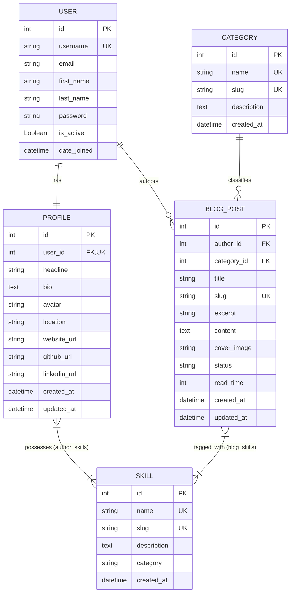
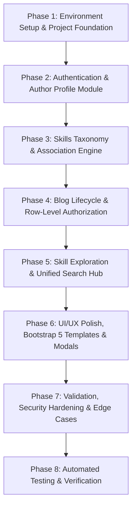

# BlogHub: Blogging and Skill Exploration Platform
## Project Architecture & Engineering Plan

**Target Project Directory:** `D:\PythonBlogProject`

---

## 1. Executive Summary & Objective

**BlogHub** is a modern, modular, server-rendered web application built with Python and Django. The platform combines technical and creative blogging with an author skill-discovery network. 

### Core Objectives:
- **User Lifecycle:** Secure registration, authentication, and profile customization with personal bio, avatars, social links, and categorized technical skills.
- **Content Publishing:** Full CRUD (Create, Read, Update, Delete) blog lifecycle with rich formatting, cover images, automatic reading-time calculation, category classification, and skill tagging.
- **Skill-Based Discovery:** A dedicated exploration engine allowing readers to discover authors and articles indexed by specific skills and domains (e.g., Python, Machine Learning, UI/UX, Cloud Architecture).
- **Security & Authorization:** Strict row-level ownership enforcement ensuring authors can only edit or delete their own posts, combined with rigorous server-side form and file validation.

---

## 2. Technology Stack & Architectural Decisions

### 2.1 Technology Stack
| Layer | Technology | Details / Purpose |
| :--- | :--- | :--- |
| **Backend Framework** | Python 3.10+ / Django 5.x | High-productivity, batteries-included MTV web framework |
| **Database** | MySQL 8.x | Robust relational database accessed via Django ORM and `mysqlclient` |
| **Frontend Templates** | Django Template Language (DTL) | Server-Side Rendering (SSR) for optimal performance and SEO |
| **UI Framework** | Bootstrap 5.3 + Bootstrap Icons | Responsive grid, cards, modals, form controls, and navbar |
| **Custom Styling** | Custom CSS3 | Modern typography, subtle shadows, and branded color palettes |
| **Client Scripting** | Vanilla JavaScript (ES6+) | Confirmation modals, image upload previews, toast notifications |
| **Configuration** | `python-dotenv` | Twelve-Factor App compliance; secrets isolated in `.env` |
| **Asset Pipeline** | Django Static & Media Pipelines | Managed local/cloud asset storage for profile avatars and covers |

### 2.2 Architectural Pattern: Django MTV (Model-Template-View)
The system strictly adheres to the monolithic Django MTV design pattern:
- **Models:** Define domain entities, database schemas, relations, and business validation constraints.
- **Templates:** Dynamic HTML documents rendered on the server with context data, styled cleanly with Bootstrap 5.
- **Views:** Handle incoming HTTP requests, enforce authentication and authorization policies, invoke forms for validation, and return HTTP responses or redirects.
- **Forms & ModelForms:** Provide single-source-of-truth validation for user input and file uploads before database persistence.

```
                    +------------------------------------------+
                    |              Client Browser              |
                    +------------------------------------------+
                                         |
                                  HTTP Request /
                                  CSRF Protected
                                         v
+-----------------------------------------------------------------------------------+
| Django Core Framework                                                             |
|                                                                                   |
|  +------------------+         +------------------+         +-------------------+  |
|  |   URL Dispatch   | ------> |      Views       | <-----> |   Forms &         |  |
|  |   (urls.py)      |         | (CBVs / FBVs)    |         |   Validators      |  |
|  +------------------+         +------------------+         +-------------------+  |
|                                         |                            |            |
|                               +---------+---------+                  |            |
|                               |                   |                  |            |
|                               v                   v                  |            |
|                     +-------------------+   +-------------------+    |            |
|                     | Django Templates  |   |    Django ORM     | <--+            |
|                     |  (Bootstrap 5)    |   |     (Models)      |                 |
|                     +-------------------+   +-------------------+                 |
+-------------------------------------------------------|---------------------------+
                                                        |
                                                        v
                                              +-------------------+
                                              |   MySQL 8.x DB    |
                                              +-------------------+
```

---

## 3. Modular Django Application Structure

To maintain separation of concerns, the project is organized into modular apps under `D:\PythonBlogProject`:

```
D:\PythonBlogProject\
├── .env.example                     # Sample configuration template
├── .gitignore                       # Git ignore rules for Python, media, .env
├── manage.py                        # Django administrative CLI
├── requirements.txt                 # Project dependencies
├── PROJECT_PLAN.md                  # Complete architectural plan
├── bloghub/                         # Root configuration package
│   ├── __init__.py
│   ├── asgi.py
│   ├── settings.py                  # Core configuration (MySQL, apps, media)
│   ├── urls.py                      # Root URL routing table
│   └── wsgi.py
├── apps/                            # Modular domain applications
│   ├── __init__.py
│   ├── core/                        # Core marketing, homepage, and search views
│   │   ├── __init__.py
│   │   ├── apps.py
│   │   ├── urls.py
│   │   └── views.py
│   ├── accounts/                    # Authentication, user profiles, and authors
│   │   ├── __init__.py
│   │   ├── admin.py
│   │   ├── apps.py
│   │   ├── forms.py                 # RegistrationForm, ProfileForm
│   │   ├── models.py                # Profile model
│   │   ├── signals.py               # Post-save trigger to auto-create Profile
│   │   ├── urls.py
│   │   └── views.py
│   ├── skills/                      # Skills taxonomy and skill explorer
│   │   ├── __init__.py
│   │   ├── admin.py
│   │   ├── apps.py
│   │   ├── forms.py                 # SkillAdminForm
│   │   ├── models.py                # Skill model
│   │   ├── urls.py
│   │   └── views.py
│   └── blogs/                       # Blog posts, categories, and author CRUD
│       ├── __init__.py
│       ├── admin.py
│       ├── apps.py
│       ├── forms.py                 # BlogPostForm, CategoryForm
│       ├── models.py                # Category, BlogPost models
│       ├── urls.py
│       └── views.py
├── static/                          # Global static assets
│   ├── css/
│   │   └── style.css                # Custom visual enhancements
│   ├── js/
│   │   └── main.js                  # Modals, alerts, form dynamic helpers
│   └── images/
│       ├── default_avatar.png       # Fallback user avatar
│       └── default_cover.jpg        # Fallback blog cover
├── media/                           # User-uploaded files (excluded from git)
│   ├── profiles/                    # Author avatars
│   └── blogs/                       # Blog post header/cover images
└── templates/                       # Master Django templates
    ├── base.html                    # Master layout (HTML5 skeleton, head, scripts)
    ├── navbar.html                  # Responsive Bootstrap 5 top navigation
    ├── footer.html                  # Global footer with functional links
    ├── messages.html                # Bootstrap toast/alert notifications
    ├── 403.html                     # Permission denied template
    ├── 404.html                     # Page not found template
    ├── 500.html                     # Server error template
    ├── core/
    │   ├── home.html                # Homepage with hero, featured blogs, top skills
    │   ├── search.html              # Unified search results (blogs + authors + skills)
    │   └── about.html               # About BlogHub platform
    ├── accounts/
    │   ├── register.html            # Registration form
    │   ├── login.html               # Authentication login form
    │   ├── profile_detail.html      # Public author profile with skills & posts
    │   ├── profile_edit.html        # Profile & skills editing form
    │   └── author_list.html         # Author directory with skill filtering
    ├── skills/
    │   ├── skill_list.html          # Skill exploration directory & metrics
    │   └── skill_detail.html        # Filtered blogs and authors for a specific skill
    └── blogs/
        ├── blog_list.html           # Paginated blog stream with filters
        ├── blog_detail.html         # Full blog reading view with author bio
        ├── blog_form.html           # Unified Create / Update blog form
        ├── blog_confirm_delete.html # Deletion confirmation modal/view
        └── my_blogs.html            # Author dashboard of owned drafts & published posts
```

---

## 4. Database Entity Relationships (ERD)

### 4.1 Mermaid Entity-Relationship Diagram



### 4.2 Data Models Specification

#### 1. `accounts.Profile`
- **Relationship:** One-to-One with `django.contrib.auth.models.User` (Cascade deletion).
- **Auto-Provisioning:** Connected to Django `post_save` signal on `User` to guarantee every user has a corresponding `Profile` upon registration.
- **Fields:**
  - `user`: `OneToOneField(User, on_delete=models.CASCADE, related_name='profile')`
  - `headline`: `CharField(max_length=150, blank=True)` (e.g., "Full-Stack Python Engineer & Cloud Architect")
  - `bio`: `TextField(max_length=1000, blank=True)`
  - `avatar`: `ImageField(upload_to='profiles/avatars/', blank=True, null=True)`
  - `location`: `CharField(max_length=100, blank=True)`
  - `website_url`: `URLField(blank=True)`
  - `github_url`: `URLField(blank=True)`
  - `linkedin_url`: `URLField(blank=True)`
  - `skills`: `ManyToManyField('skills.Skill', related_name='authors', blank=True)`
  - `created_at`, `updated_at`: `DateTimeField`

#### 2. `skills.Skill`
- **Purpose:** Represents a technical skill or domain topic shared across author profiles and blog posts.
- **Fields:**
  - `name`: `CharField(max_length=50, unique=True)`
  - `slug`: `SlugField(max_length=60, unique=True)`
  - `description`: `TextField(blank=True)`
  - `category`: `CharField(max_length=50, choices=SKILL_CATEGORIES)` (e.g., Frontend, Backend, AI/Data, DevOps, Mobile, Security)
  - `created_at`: `DateTimeField(auto_now_add=True)`

#### 3. `blogs.Category`
- **Purpose:** High-level editorial classification for blogs (e.g., Tutorials, System Design, Career, Insights).
- **Fields:**
  - `name`: `CharField(max_length=50, unique=True)`
  - `slug`: `SlugField(max_length=60, unique=True)`
  - `description`: `TextField(blank=True)`

#### 4. `blogs.BlogPost`
- **Purpose:** The core article entity.
- **Fields:**
  - `author`: `ForeignKey(User, on_delete=models.CASCADE, related_name='blogs')`
  - `title`: `CharField(max_length=200)`
  - `slug`: `SlugField(max_length=250, unique=True)` (Auto-populated with unique counter fallback)
  - `category`: `ForeignKey(Category, on_delete=models.SET_NULL, null=True, blank=True, related_name='blogs')`
  - `skills`: `ManyToManyField('skills.Skill', related_name='blogs', blank=True)`
  - `excerpt`: `CharField(max_length=300, help_text="Summary for cards and search results")`
  - `content`: `TextField(help_text="Full blog post content in formatted HTML/Markdown")`
  - `cover_image`: `ImageField(upload_to='blogs/covers/', blank=True, null=True)`
  - `status`: `CharField(max_length=10, choices=[('draft', 'Draft'), ('published', 'Published')], default='published')`
  - `read_time`: `PositiveIntegerField(default=1)` (Auto-calculated on save: ~200 words per minute)
  - `created_at`: `DateTimeField(auto_now_add=True)`
  - `updated_at`: `DateTimeField(auto_now=True)`

---

## 5. Comprehensive URL Plan

All application endpoints are structured logically, REST-like, and cleanly mapped to views:

| URL Pattern | HTTP Method | View Name | App / View Class or Function | Access Level | Description |
| :--- | :--- | :--- | :--- | :--- | :--- |
| `/` | `GET` | `home` | `core:home` | Public | Homepage: Hero, featured blogs, top skills, author spotlight |
| `/search/` | `GET` | `search` | `core:search` | Public | Multi-entity search across blogs, authors, and skills |
| `/about/` | `GET` | `about` | `core:about` | Public | About the BlogHub platform |
| **Authentication & Profile** | | | | | |
| `/accounts/register/` | `GET`, `POST` | `register` | `accounts:register` | Anonymous | User registration with server validation |
| `/accounts/login/` | `GET`, `POST` | `login` | `accounts:login` | Anonymous | User login with session management & messages |
| `/accounts/logout/` | `POST` | `logout` | `accounts:logout` | Authenticated | Secure logout (CSRF protected) |
| `/accounts/profile/edit/` | `GET`, `POST` | `profile_edit` | `accounts:profile_edit` | Authenticated | Edit own headline, bio, avatar, skills, links |
| `/authors/` | `GET` | `author_list` | `accounts:author_list` | Public | Directory of authors with skill filtering and search |
| `/authors/<str:username>/` | `GET` | `author_detail` | `accounts:author_detail` | Public | Public author profile with their skills and published posts |
| **Blog Management** | | | | | |
| `/blogs/` | `GET` | `blog_list` | `blogs:blog_list` | Public | Published blogs feed with pagination and filters |
| `/blogs/create/` | `GET`, `POST` | `blog_create` | `blogs:blog_create` | Authenticated | Create a new blog post with cover image & skills |
| `/blogs/<slug:slug>/` | `GET` | `blog_detail` | `blogs:blog_detail` | Public / Author | Read single blog post; shows draft only if author |
| `/blogs/<slug:slug>/edit/` | `GET`, `POST` | `blog_update` | `blogs:blog_update` | Author Only | Update blog post (strict 403 ownership enforcement) |
| `/blogs/<slug:slug>/delete/` | `GET`, `POST` | `blog_delete` | `blogs:blog_delete` | Author Only | Delete confirmation & execution (strict 403) |
| `/my-blogs/` | `GET` | `my_blogs` | `blogs:my_blogs` | Authenticated | Dashboard listing author's own drafts and published posts |
| **Skill Exploration** | | | | | |
| `/skills/` | `GET` | `skill_list` | `skills:skill_list` | Public | Exploration hub of all skills with post & author counts |
| `/skills/<slug:slug>/` | `GET` | `skill_detail` | `skills:skill_detail` | Public | View all authors and blogs associated with a skill |

---

## 6. Security, Validation & Business Rules

1. **Strict Ownership Enforcement:**
   - Any attempt by User A to edit or delete User B's blog post will be trapped by both view logic (`UserPassesTestMixin` or explicit conditional check) and raise an `HttpResponseForbidden` (403).
   - Edit and Delete buttons are rendered in the template **only** if `request.user == blog.author`.
2. **Password Security:**
   - Passwords are never stored in plain text. Django's built-in `PBKDF2PasswordHasher` with SHA256 is utilized.
   - Enforce minimum length, common password checking, numeric and attribute similarity validation via Django `AUTH_PASSWORD_VALIDATORS`.
3. **Server-Side File & Image Validation:**
   - File uploads (avatars, covers) are validated on the server for:
     - Allowed extensions: `.jpg`, `.jpeg`, `.png`, `.webp`.
     - File size limits: Max 2MB for avatars, Max 5MB for blog cover images.
     - Server-side image dimension and format inspection using Pillow.
4. **Input Sanitization & Protection:**
   - Full CSRF protection on all forms via ``.
   - SQL Injection protection via Django ORM parameterized queries.
   - Cross-Site Scripting (XSS) mitigation via DTL default autoescaping.
5. **Environment Isolation:**
   - Sensitive credentials (`SECRET_KEY`, `DB_NAME`, `DB_USER`, `DB_PASSWORD`, `DB_HOST`, `DB_PORT`) are strictly kept in `.env` and loaded via `python-dotenv`.
   - `.env` is explicitly included in `.gitignore`.

---

## 7. Development Phases & Roadmap



### Phase 1: Environment Setup & Foundation
- Set up virtual environment and install core requirements (`django`, `mysqlclient`, `python-dotenv`, `pillow`).
- Initialize Django project `bloghub` with structured modular apps layout (`core`, `accounts`, `skills`, `blogs`).
- Configure MySQL database settings with environment variables.
- Establish global templates directory, static directory, and media directory.
- Build master layout (`base.html`), responsive navbar with conditional auth links, and alert message rendering.

### Phase 2: Authentication & Author Profile Module (`accounts`)
- Build `Profile` model with avatar, headline, bio, location, and social links.
- Create Django signals (`post_save`) to automatically create/save a `Profile` when a `User` registers.
- Implement registration form with password confirmation and clean methods.
- Implement login and logout flows with user feedback messages.
- Build profile edit view with avatar upload validation and live preview.
- Construct public author profile view showcasing author statistics and bio.

### Phase 3: Skills Taxonomy & Association Engine (`skills`)
- Build `Skill` model with unique slugs and categories (Frontend, Backend, AI, Cloud, etc.).
- Associate skills with `Profile` (M2M) and populate seed skills via a management command or fixture.
- Implement skill selection UI in the profile edit screen (multi-select / badge selection).
- Create public skill listing page showcasing all skills with post count and author count badges.
- Create skill detail page filtering authors and blogs tagged with that specific skill.

### Phase 4: Blog Lifecycle & Row-Level Authorization (`blogs`)
- Build `Category` and `BlogPost` models with M2M connection to `Skill`.
- Implement automated slug generation with deduplication logic.
- Implement automated reading time calculation based on word count.
- Build `BlogPostForm` with image validation and skill picker.
- Implement Blog CRUD views:
  - `blog_list`: Paginated public stream with category and skill filters.
  - `blog_detail`: Public view of published post (draft view restricted to author).
  - `blog_create`: Authenticated author post creation.
  - `blog_update`: Strictly restricted to post owner (403 if unauthorized).
  - `blog_delete`: Strictly restricted to post owner with deletion confirmation.
- Build `my_blogs` author dashboard showing drafts and published status.

### Phase 5: Skill Exploration & Unified Search Hub
- Build `core:search` view with multi-entity lookup:
  - Search blog posts by title, excerpt, content, or author username.
  - Search authors by username, headline, or skills.
  - Search skills by name or category.
- Build `accounts:author_list` with search and skill filter pills.
- Ensure all skill badges across the application are clickable links navigating directly to `/skills/<slug>/`.

### Phase 6: UI/UX Polish, Bootstrap 5 Templates & Modals
- Implement clean, responsive Bootstrap 5 styling with cards, badges, and responsive tables.
- Add confirmation modal dialogs for destructive actions (e.g., delete blog).
- Style flash messages (success, warning, danger, info) cleanly.
- Verify zero dead links or dummy buttons across all templates.
- Implement custom error templates (`403.html`, `404.html`, `500.html`).

### Phase 7: Validation, Security Hardening & Edge Cases
- Test file upload size limits (reject images > 2MB / 5MB with friendly form errors).
- Verify CSRF protection across all POST actions.
- Test XSS safety with HTML escaping.
- Verify that drafts are never visible in the public blog feed or search results.

### Phase 8: Automated Testing & Verification
- Unit and integration tests covering:
  - User registration and profile signal creation.
  - Blog post creation and reading time calculation.
  - Ownership test: Author A cannot edit Author B's post (HTTP 403).
  - Draft privacy: Unauthenticated/other users cannot view drafts (HTTP 404/403).
  - Search querying accuracy.

---

## 8. Comprehensive Testing Strategy

### 8.1 Automated Test Suites (`tests.py` in each app)

| Test Module | Target | Test Cases |
| :--- | :--- | :--- |
| `accounts.tests` | `Profile` & Signals | • User creation triggers Profile creation automatically.<br>• Profile string representation.<br>• Valid registration logs user in.<br>• Duplicate email/username validation errors. |
| `accounts.tests` | Profile Editing | • User can update bio, headline, and skills.<br>• Invalid avatar file format rejected.<br>• Oversized avatar (>2MB) rejected. |
| `blogs.tests` | `BlogPost` Model | • Slug generation creates clean slug.<br>• Duplicate titles generate unique slugs (`title-1`, `title-2`).<br>• Reading time calculated accurately. |
| `blogs.tests` | Authorization & Permissions | • Unauthenticated user redirected to login when accessing `/blogs/create/`.<br>• Author can edit their own blog.<br>• User B receives **403 Forbidden** when attempting `GET` or `POST` on User A's `/blogs/<slug>/edit/`.<br>• User B receives **403 Forbidden** when attempting delete on User A's post. |
| `blogs.tests` | Filtering & Drafts | • Published posts appear in `/blogs/`.<br>• Draft posts do **not** appear in public feed.<br>• Other users accessing draft URL get **404 Not Found**. |
| `skills.tests` | Skills Engine | • Skill slug generation.<br>• Associating skill to blog and author.<br>• Skill detail page lists only matching authors and published blogs. |

---

## 9. Verification & Success Criteria

1. **Database:** Migrations apply cleanly to MySQL without warnings or orphaned keys.
2. **Authentication:** Registration, login, session retention, and logout function seamlessly with flash messages.
3. **Blog Workflow:** Authors can draft, publish, update, and delete their own blogs with functional cover image uploads.
4. **Security Check:** Non-owners are strictly prevented from modifying or deleting posts.
5. **Skill Discovery:** Readers can discover authors by skills and explore blogs tagged with matching skills.
6. **Code Quality:** Fully modular Django apps, PEP-8 compliant, well-commented, no hardcoded secrets.
